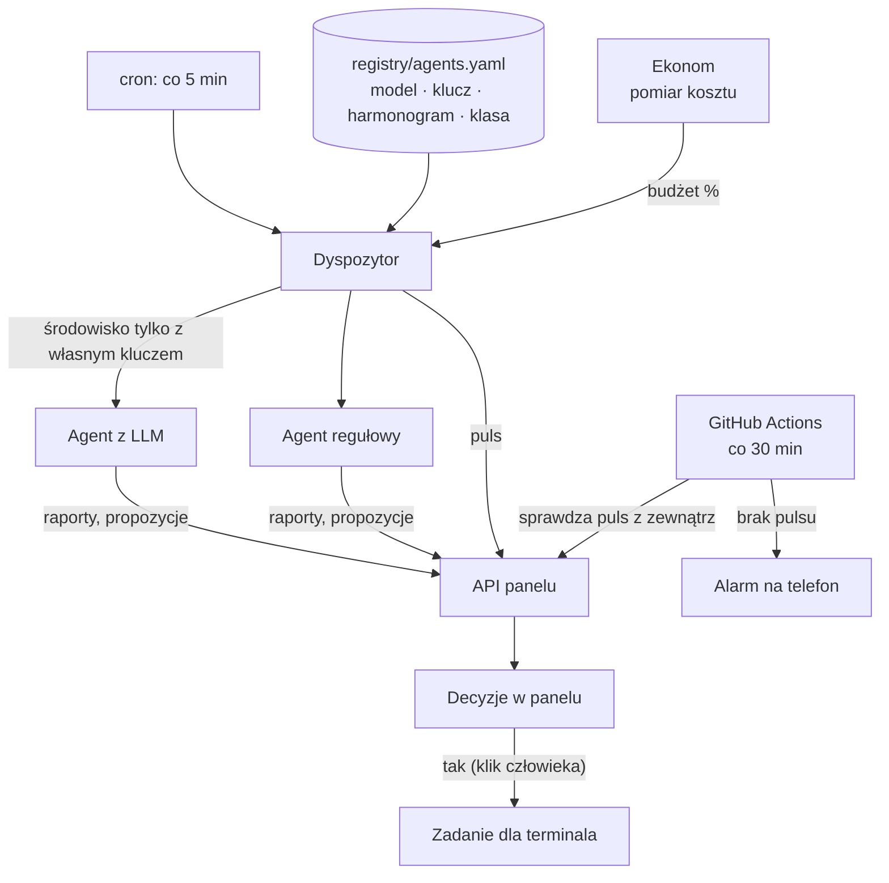
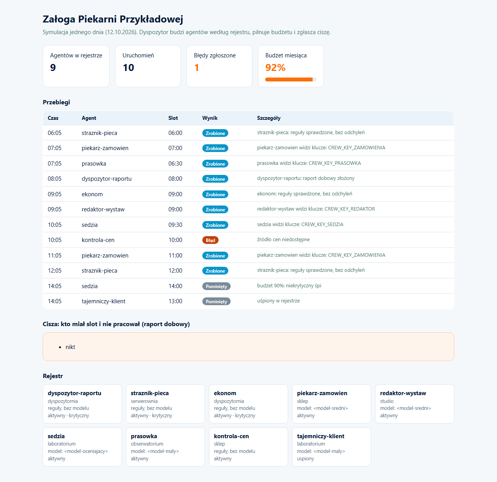

# Agent Crew Orchestrator


Ponad 50 stałych agentów AI pracujących na serwerze jak zespół: każdy ma etat, harmonogram, własny klucz z limitem i kartę obowiązków. Jeden dyspozytor ich budzi i pilnuje budżetu.

*50+ scheduled AI agents working like a team: each has a role, a schedule, its own rate-limited key and a duty card. One dispatcher wakes them and guards the budget.*

> Wizytówka projektu. Kod produkcyjny jest prywatny. / Showcase repository. Production code is private.

---

## PL

### Problem
Skrypty bez właściciela: każdy z własnym cronem, własnym kluczem do wszystkiego i bez śladu, czy w ogóle zadziałał. Koszt modeli rośnie po cichu, a awaria wygląda jak spokój.

### Rozwiązanie
Załoga zbudowana wokół czterech zasad:
1. **Jeden rejestr** (`registry/agents.yaml`): kto, w którym dziale, kiedy, jakim modelem, na jakim kluczu, w jakiej klasie kosztu. Model nigdy nie jest wpisany w kodzie agenta.
2. **Jeden wpis w cronie**: Dyspozytor co 5 minut. On budzi resztę według rejestru, nadrabia przegapione sloty (do 3 godzin), zgłasza start i koniec każdego przebiegu.
3. **Agenci nie mają dostępu do bazy.** Piszą wyłącznie przez API panelu; propozycje stają się decyzjami do zatwierdzenia przez człowieka, z dziennym limitem decyzji.
4. **Kto czyta świat, nie działa w systemie.** Agenci czytający internet (prasówka, trendy, reputacja) nie mają uprawnień do zmian.

Działy: dyspozytornia, serwerownia, kuźnia (architekt, modernizator), studio (marketing), laboratorium (sędzia, egzaminator botów, testy penetracyjne, „tajemniczy klient”), dział prawny, park klientów, salon prototypów i inne. Około połowy aktywnych agentów to czyste reguły bez modelu AI.

### Architektura



### Decyzje projektowe
- **Izolacja kluczy w procesie.** Każdy agent startuje w środowisku, z którego usunięto klucze pozostałych agentów; token finansów widzą tylko agenci finansowi.
- **Budżet z progami.** Alarm przy 70% miesięcznego sufitu, przy 90% niekrytyczni agenci śpią; agenci krytyczni (straż, pomiar kosztu) nie zasypiają nigdy.
- **Cisza nie udaje spokoju.** Niezerowy kod wyjścia agenta zamienia się w raport błędu w jego imieniu; raport dobowy wymienia, kto miał slot i nie pracował.
- **Sygnał z zewnątrz.** Serwer nie może sam zgłosić, że leży, więc puls sprawdza GitHub Actions i alarmuje wprost na telefon.
- **Reguły człowieka jako pierwsza instrukcja.** Uwagi właściciela trafiają do `reguly.yaml` i są doklejane automatycznie do każdego wywołania modelu.
- **Sędzia innym modelem niż autor.** Ocena treści nigdy nie jest robiona tym samym modelem, który ją napisał.

### Wybrany fragment kodu

```python
def srodowisko(agent: str, reg: dict) -> dict:
    """Agent dostaje tylko własny klucz modelu: klucze pozostałych agentów znikają z jego środowiska."""
    wlasny = reg['agenci'].get(agent, {}).get('klucz')
    cudze = {a.get('klucz') for n, a in reg['agenci'].items()
             if n != agent and (a.get('klucz') or '').startswith('ZALOGA_')}
    return {k: v for k, v in os.environ.items() if k not in cudze or k == wlasny}


def sloty_do_odpalenia(harmonogram, dni, ostatnie, chwila):
    """Sloty z dziś, które już nadeszły (nie dawniej niż 3 h) i jeszcze nie ruszyły."""
    if dni is not None and chwila.weekday() not in dni:
        return []
    wynik = []
    for godz in harmonogram:
        h, m = map(int, godz.split(':'))
        slot = chwila.replace(hour=h, minute=m, second=0, microsecond=0)
        klucz = f'{slot.date().isoformat()} {godz}'
        if slot <= chwila < slot + NADROBIENIE and ostatnie.get(godz) != klucz:
            wynik.append(godz)
    return wynik
```

Przykładowy wpis rejestru (wartości poglądowe):

```yaml
sedzia: {budynek: lab, stan: aktywny, model: <model-oceniajacy>, klasa: rzadki,
         klucz: ZALOGA_SEDZIA_OR_KEY, harmonogram: ["09:00", "14:00", "20:00"]}
mechanik: {budynek: serwer, stan: aktywny, krytyczny: true, model: null, klasa: skrypt}
```

### Stack
Python 3, PyYAML, OpenRouter (wiele modeli, dostawcy bez zbierania danych), PostgreSQL przez API panelu, cron, GitHub Actions, Playwright (agent testujący interfejs).

### Efekt
W rejestrze 55 agentów, z czego 50 aktywnych (stan na 7.10.2026); ok. 8 tys. linii Pythona i 25 plików testów. Testy pilnują m.in., że każdy aktywny agent ma adres w panelu, a każdy dział ma kierownika.

---

## EN

**Problem.** Ownerless scripts: each with its own cron, a key to everything, no trace of whether it ran. Model costs grow silently and a crash looks like calm.

**Solution.** A crew built on four rules. One registry (model, key, schedule, cost class per agent; models never hardcoded). One cron entry: a dispatcher every 5 minutes that wakes agents per the registry and catches up missed slots. Agents never touch the database; they write through the dashboard API, and proposals become human decisions with a daily cap. Whoever reads the outside world cannot act inside the system.

**Design decisions.** Per-process key isolation. Budget thresholds (alert at 70%, non-critical agents sleep at 90%, critical ones never). Non-zero exit codes become error reports, and a daily report lists who missed a slot. External heartbeat from GitHub Actions. Owner rules injected as the first system message. The judge model always differs from the author model.

**Result.** 55 agents in the registry, 50 active (as of 2026-10-07); about half are pure rules with no LLM. ~8k lines of Python, 25 test files.

## Jak uruchomić / Run it

Przykład w repozytorium to działający, uproszczony szkielet na firmie fikcyjnej (Piekarnia Przykładowa): 9 agentów, rejestr, dyspozytor, izolacja kluczy, progi budżetu, raport ciszy. Produkcyjna załoga jest większa i prywatna.
*A working, simplified skeleton on a fictional company: 9 agents, registry, dispatcher, key isolation, budget thresholds, silence report.*

```bash
pip install -r requirements.txt
python -m pytest -q                 # 11 testów dyspozytora
python demo/make_demo.py            # symulacja dnia, zapisuje demo/report.html
python -m crew.dispatcher --now "2026-10-12 09:05" --state /tmp/stan   # jeden obrót dyspozytora
python demo/screenshot.py           # (opcjonalnie) zrzut przez Playwright: playwright install chromium
```

Struktura: `registry/agents.yaml` (rejestr), `crew/dispatcher.py` (dyspozytor), `agents/` (agenci poglądowi, nie wołają żadnego API), `tests/`, `demo/`.

### Demo: jeden dzień pracy załogi

Symulacja: agenci budzą się według rejestru, jeden wywala się i zostaje zgłoszony, o 92% budżetu agenci niekrytyczni śpią, a raport dobowy wymienia ciszę.
*Simulated day: agents wake per registry, one crashes and is reported, at 92% budget non-critical agents sleep.*



---

<p align="center"><br>
Zbudowane w <a href="https://cyfrownia.com">Cyfrowni</a>, agencji AI z Grudziądza. Kontakt: <a href="mailto:biuro@cyfrownia.com">biuro@cyfrownia.com</a></p>
